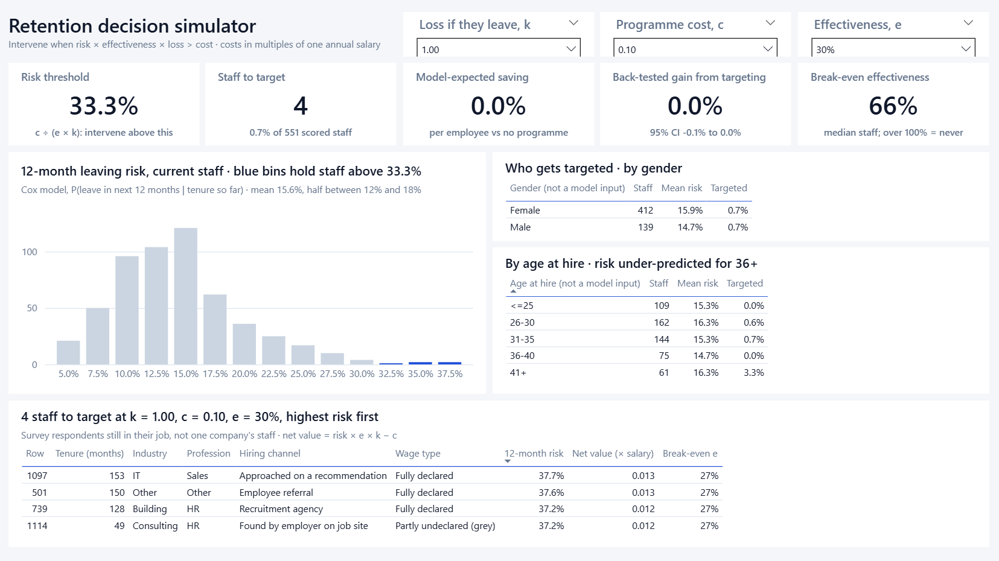
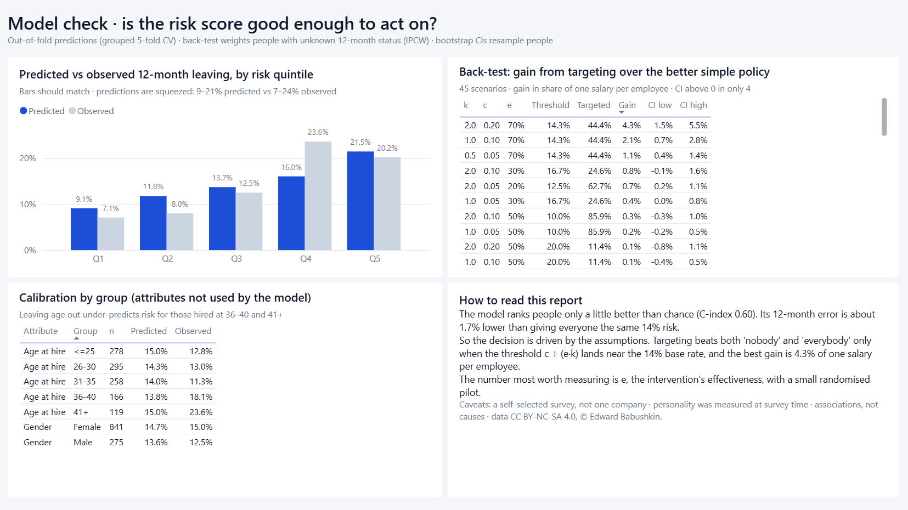

# Employee Turnover: Survival Analysis and Retention Decisions

The business question is: **"Given who someone is and how they were hired, how likely are they to leave in the next 12 months, and is a retention intervention worth paying for?"**

The project answers it in two layers:

1. **Prediction.** Kaplan–Meier curves, log-rank tests and a Cox proportional-hazards model of time to leaving, all on real employee data.
2. **Decision.** A cost rule that turns a predicted leaving probability into intervene / don't intervene. The rule is back-tested against the simple alternatives of intervening on nobody or on everybody.

**Deliverables:** this analysis, a **[two-page decision memo](docs/decision_memo.md)** for an HR director, and a **Power BI report** ([powerbi/HRAttrition.pbip](powerbi/HRAttrition.pbip)) with a decision simulator.

The main finding is negative, and it is the useful one. The model ranks people better than chance (C-index 0.60), but not by enough to change many decisions. **Assumptions about intervention cost and effectiveness drive the answer far more than the model does.** Targeting beats both simple policies only when the cost threshold falls close to the base leaving rate.

## Data

**[Employee Turnover](https://www.kaggle.com/datasets/davinwijaya/employee-turnover)** (`turnover.csv`) was collected by people analyst Edward Babushkin ([blog post, 2017](https://edwvb.blogspot.com/2017/10/employee-turnover-how-to-predict-individual-risks-of-quitting.html): *"The dataset is real"*). It is redistributed on Kaggle under **CC BY-NC-SA 4.0**, so it is for non-commercial use with attribution. The raw file is not included in this repository: `scripts/01_fetch_data.py` downloads it and checks its SHA-256. The Power BI extracts in `powerbi/data/` are derived from it and carry the same licence.

The following is from Babushkin's Russian-language blog posts, found with a web lookup. Apart from the 2017 post, I have not checked it line by line.

- **Collection.** An open online survey (2015–2017) of Russian-speaking office workers. Respondents described **one** job, their current or a recent one, with hire date and exit date if they had left. They also answered a Big Five personality questionnaire. HR specialists are heavily over-represented (67% of rows).
- `stag`: tenure in months (days / 30.4375). `event`: 1 = left, 0 = still there (censored).
- `age`: age **at hire**.
- `traffic`: how the person was hired:

  | code | meaning |
  |---|---|
  | `youjs` | applied to a vacancy on a job site |
  | `empjs` | employer found their CV on a job site |
  | `rabrecNErab` | employer approached them on someone's recommendation |
  | `referal` | recommended by an employee of the company |
  | `recNErab` | recommended by an acquaintance who did not work there |
  | `friends` | invited by an employer they already knew |
  | `advert` | applied directly (advert, employer brand) |
  | `KA` | recruitment agency |

- `coach`: mentor during probation, with values `no`, `yes` (another specialist) or `my head` (their own manager).
- `greywage`: `grey` means part of the salary is not declared to the tax authorities.
- `way`: how they commute.

### Data quality (read before reusing)

| Issue | What I did |
|---|---|
| 13 exact duplicate rows | Dropped. 1,129 rows become **1,116**, with 560 leavers. |
| 510 rows share a full personality profile, or a tenure/age/job record, with another row: likely the same person entered more than once | Rows are linked into **771 "person groups"** (connected components). CV folds and bootstrap resamples never split a group, and test standard errors are cluster-robust. Ignoring the grouping inflates the CV C-index from 0.613 to 0.623, which is exactly the leakage the grouping prevents. |
| `Finance` is garbled (a Cyrillic letter) and `HoReCa` has a leading space | Fixed in `data.clean`. |
| Categories with fewer than 30 rows | Pooled into `other` for modelling. |
| No salary column | Costs are expressed in **multiples of annual salary**. When both costs scale with salary, salary cancels out of the decision rule (see below). |

**Limitations that no code can fix.** The data is a self-selected survey, not one company's HR records, so "current staff" means respondents still in the job they described. Personality was measured at survey time, possibly after the person left. Exits are self-reported.

## Pipeline

```
run_all.ps1
  01_fetch_data       Kaggle download + checksum
  02_survival_tests   KM curves, log-rank and cluster-robust Wald tests, Benjamini-Hochberg
  03_cox              Cox PH: penalty tuned on a held-out split, grouped 5-fold CV x 5 repeats,
                      calibration, PH test, hazard ratios, grouped bootstrap CIs
  04_decision         cost rule, IPCW back-test over 45 cost scenarios, current-staff scores,
                      fairness audit
  05_export_bi        CSV extracts for Power BI (readable labels, no re-estimation)
  06_build_pbip       generates the Power BI project (TMDL model + PBIR report) from code
  pytest              11 tests (decision maths, IPCW weights, grouped folds, data invariants)
```

Setup: `py -3.13 -m venv .venv; .\.venv\Scripts\pip install -r requirements.txt`. A Kaggle token is needed in `~/.kaggle/access_token`. A full run takes about 3 minutes.

## Results

### 1. Who leaves, and when (`02_survival_tests`)

The median tenure is **51 months**. 14% of people leave within 12 months and 30% within 24 months.

| Factor | Robust p | BH q | Pattern |
|---|---|---|---|
| Industry | <0.001 | <0.001 | Banks, Building, Consulting and State leave fastest (about 20–25% gone in year 1). IT, Power and Telecom are slowest. |
| Grey wage | <0.001 | <0.001 | Median tenure is **26 months on a grey wage vs 54 on a white wage**. |
| Age band at hire (protected) | <0.001 | <0.001 | Those hired aged 36 or older leave sooner. |
| Hiring channel | 0.002 | 0.005 | People who came through friends, referrals or direct applications stay longest. Job-site hires stay shortest. |
| Commute | 0.002 | 0.005 | Bus commuters leave sooner than car or foot commuters. |
| Profession | 0.012 | 0.023 | Marketing leaves fastest. IT is slowest. |
| Self-control, extraversion | ≈0.013 | 0.023 | Small effects: hazard ratio about 0.9 and 1.1 per SD. |
| Coach during probation | 0.23 | 0.30 | **No detectable effect.** |
| Gender, supervisor gender | >0.1 | >0.19 | No detectable effect. |

### 2. Cox model (`03_cox`)

The **decision model** leaves out gender, age and supervisor gender. The **full model** adds them, to measure what excluding them costs.

| Metric (grouped CV, 5 repeats) | Null (KM) | Decision model | Full model |
|---|---|---|---|
| Harrell's C | 0.500 | **0.603** (bootstrap 95% CI 0.581–0.643) | 0.607 |
| Brier score, P(leave by 12 months) | 0.1234 | 0.1213 | 0.1211 |

- **The model is weak, but better than nothing.** The Brier score improves on the null model by only about 1.7%, though the bootstrap CI for that gain (0.0004–0.0052) excludes zero.
- **Excluding protected attributes costs almost nothing**: the C-index drops by 0.004.
- **The proportional-hazards assumption holds.** Schoenfeld tests give no covariate with p < 0.05 (31 tests).
- **The penalty** (L2, 0.3) was chosen on a separate CV split that is not reused for evaluation.
- **Calibration** (`figures/calibration_12m.png`) is compressed. Predictions range from about 0.09 to 0.21, while observed rates range from 0.07 to 0.24. The bottom two quintiles are over-predicted and the fourth is under-predicted.
- **Hazard ratios** (`figures/hazard_ratios.png`, unpenalised fit with cluster-robust CIs, relative to Retail / HR / job-site applicant / white wage / bus):
  - Building 2.4, Banks 2.2, Consulting 2.0
  - grey wage 1.7, Marketing 1.7
  - direct application 0.51, non-employee recommendation 0.51, friends 0.59, employee referral 0.70

These are associations in survey data, not causes. For example, "grey wage" probably marks a kind of employer rather than being a lever HR can pull.

### 3. Decision layer (`04_decision`)

All costs are in units of **one annual salary**:

- `k`: cost of losing someone (replacement, ramp-up, lost output). The usual rule of thumb is 0.5–2.
- `c`: cost of the intervention.
- `e`: effectiveness, meaning the share of would-be leavers the intervention keeps.

Intervening on someone with leaving probability `p` saves `p·e·k` and costs `c`, so it pays when **`p > c / (e·k)`**. When both `k` and `c` scale with salary, salary cancels out, which is why the missing salary column doesn't matter. For a fixed-price programme it does not cancel: the cut-off falls as salary rises. The rule only works if `p` is calibrated, which is why calibration is reported above. For each current employee the output also gives the **break-even effectiveness** `c / (p·k)`: how well an intervention would have to work to pay for itself.

**Back-test.** Out-of-fold P(leave within 12 months of hire) was compared with what actually happened. Inverse-probability-of-censoring weights account for people whose 12-month outcome is unknown. The test covered 45 scenarios: k ∈ {0.5, 1, 2} × c ∈ {0.05, 0.1, 0.2} × e ∈ {0.1, …, 0.7}.

| | |
|---|---|
| Scenarios where the rule splits people (5–95% targeted) | 11 of 45. In the rest, the threshold is outside the 0.05–0.38 range of predictions, so the rule reduces to "nobody" or "everybody". |
| Scenarios where targeting beats the better simple policy (bootstrap CI > 0) | **4 of 11**. All have thresholds of 0.125–0.143, next to the 14% base rate. |
| Largest saving | 4.3% of one salary per employee (k = 2, c = 0.2, e = 0.7) |
| Base case (k = 1, c = 0.1, e = 0.3) | The threshold is 0.33, so 4 of 551 current staff would be targeted. In practice the rule says "don't run this programme". |

`figures/targeting_gain.png` and `figures/cost_vs_threshold.png` show this. The model matters only when the economics are already on the fence. Elsewhere, the cost assumptions decide everything, so **the most valuable number to estimate is `e`, not a better C-index**. A randomised pilot of the intervention would be worth more than a better model. It must be large enough: detecting a fall from 20% to 14% needs about 600 people per arm (80% power).

The bootstrap intervals hold the model's predictions fixed, so they understate the uncertainty.

### 4. Fairness audit

Gender, age and supervisor gender are not model inputs. They are used only to check the results.

- **Gender:** calibration is similar (women: predicted 0.147, observed 0.150; men: 0.136, 0.125). In the optimistic scenario, men are targeted less (79% vs 89%) because their predicted risk is lower.
- **Age:** leaving age out makes the model **under-predict** for people hired at 36–40 (predicted 0.138, observed 0.180) and at 41+ (0.150, 0.236). These people would be under-targeted relative to their true risk. This is the "fairness through unawareness" problem, which shows up here in the data: excluding an attribute does not make the outcome neutral with respect to it. A deployment should monitor calibration by age group, and possibly recalibrate per group.

## Power BI report

Open `powerbi/HRAttrition.pbip` in Power BI Desktop and select **Refresh**. The data folder is set by the `DataFolder` parameter (Transform data → Edit parameters). It points to `C:\Users\courts\hr-attrition-decision\powerbi\data`, so change it if you clone the repository elsewhere. The project is generated by `scripts/06_build_pbip.py`, so changes made in Desktop are overwritten the next time the script runs.

| Page | What it shows |
|---|---|
| **Who leaves** | KPIs; Kaplan–Meier curves and first-year leaving rates for a chosen factor; hazard ratios; factor tests |
| **Decision simulator** | Pick `k`, `c` and `e` to see: the threshold; who to target; the expected saving; the back-tested gain with its CI (for scenarios in the grid); break-even effectiveness; a risk histogram; targeting by gender and age |
| **Model check** | Calibration by quintile; all 45 back-test scenarios; calibration by group; notes on how to read the report |

**Who leaves**


**Decision simulator**



**Model check**



## Files

- `reports/tables/`: every number above (`factor_tests`, `levels_km`, `cox_cv`, `cox_hazard_ratios`, `ph_test`, `calibration_12m`, `decision_grid`, `decision_grid_bootstrap`, `fairness_calibration`, `fairness_targeting`).
- `reports/*.json`: headline numbers by stage.
- `reports/figures/`: KM curves per factor, calibration, hazard ratios, cost vs threshold, targeting gain.
- `data/processed/staff_scores.csv` (not committed): one row per current employee, with conditional 12-month risk, break-even effectiveness and decisions under both scenarios. Five people whose 12-month window extends past the last observed exit (166 months) get no score, because the Cox baseline hazard is flat beyond that point.

## Credits and licence

Data © Edward Babushkin, via Kaggle (davinwijaya/employee-turnover), CC BY-NC-SA 4.0. The analysis code is for non-commercial portfolio and educational use.
