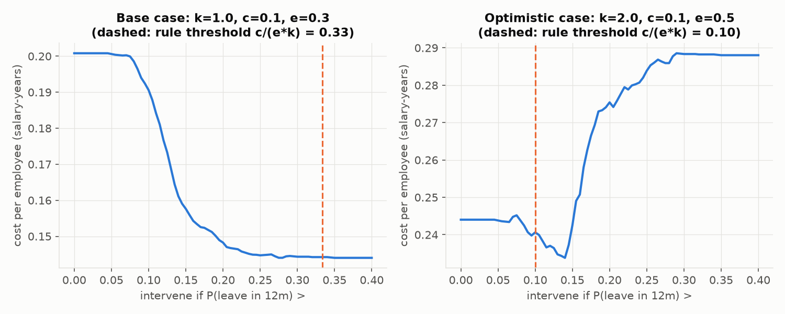

# Decision memo: should we pay to keep employees we predict will leave?

**To:** HR Director · **From:** People Analytics · **Re:** Retention programme targeting

## Recommendation

**Don't buy a turnover-prediction model to target a retention programme yet. First run a small, randomised pilot of the programme itself** to measure how many would-be leavers it actually keeps.

That one number decides whether the programme pays, and for whom. The prediction model barely changes the answer.

## What we looked at

We analysed 1,116 real employees from a survey of Russian-speaking office workers (2015–2017). For each person we know how long they stayed in one job and whether they had left. We used this to answer two questions:

1. **Who leaves, and how fast?**
2. **If we offer a retention package (a raise, training, flexibility) to the people most likely to leave, do we save more than it costs?**

## What we found

**Turnover is high.** Half of people have left by month 51. One in seven new hires (14%) leaves in the first year.

**Some groups leave much faster than others:**

| Group | First-year leaving | Typical stay |
|---|---|---|
| Part of salary paid off the books ("grey" pay) | 24% | about 2 years |
| Fully declared salary | 13% | about 4½ years |
| Banking, consulting, construction, state sector | 20–25% | about 2–4 years |
| IT, power generation, telecoms | 6–13% | 6–9 years |
| Hired through a friend or an employee referral | 8–10% | 5–6 years |
| Found by the employer on a job site | 20% | about 3 years |

A mentor during probation made no measurable difference. These are patterns, not proof of cause: grey pay probably marks a certain kind of employer more than it drives people out.

**Predicting *individuals* is much harder than describing groups.** The best model ranks people only a little better than a coin toss (60% of pairs ranked correctly, against 50% for chance). Almost everyone's predicted first-year risk falls between 5% and 38%, and most are close to the 14% average.

## Why the model doesn't settle the decision

Offering someone the package pays when:

> **chance they leave × share of leavers the package keeps × cost of losing them > cost of the package**

Costs are counted in **annual salaries**. Replacing someone typically costs half a salary to two salaries; the package might cost 5–20% of a salary. Salary then cancels out, so the rule works for any pay level.

*Left: with our central assumptions (losing someone costs one salary, the package costs 10% of one and keeps 30% of would-be leavers), the cheapest choice is to offer it to almost nobody. Right: if losing someone costs two salaries and the package keeps half of leavers, the cheapest choice is to offer it to most people. The model only fine-tunes the edges.*

We tested this against what actually happened, across 45 combinations of costs and effectiveness:

- In **34 of 45**, the right answer was (almost) "everyone" or (almost) "no one". The model played no part.
- In the remaining 11, targeting the highest-risk people beat both simple options with confidence in only **4**. The biggest saving was **4% of one salary per employee**.

So the answer depends on **how well the package works**, and we don't know that. The data can't tell us, because nobody in it received a package.

## Fairness

The model doesn't use gender or age. Even so, it **underestimates the risk for people hired at 36 or older**. For those hired at 41+, it predicts 15%, but 24% actually left in year one. They would get less help than their real risk warrants. Any rollout must check results by age group.

## Next steps

1. **Pilot:** offer the package to a random half of one high-turnover unit for 12 months and compare leaving rates. This measures effectiveness directly.
2. **Use the pilot result in the decision tool** (Power BI, "Decision simulator" page). It shows instantly who to target, and what it saves, for any cost and effectiveness.
3. **Look at the groups that leave fast.** Grey pay, job-site hiring and certain industries are worth investigating as policy questions, not just as prediction inputs.

*Caveats: the data comes from volunteers in a survey, not from one company's records. Personality scores were collected after the fact. Data © Edward Babushkin, CC BY-NC-SA 4.0. Full method: [README](../README.md).*
